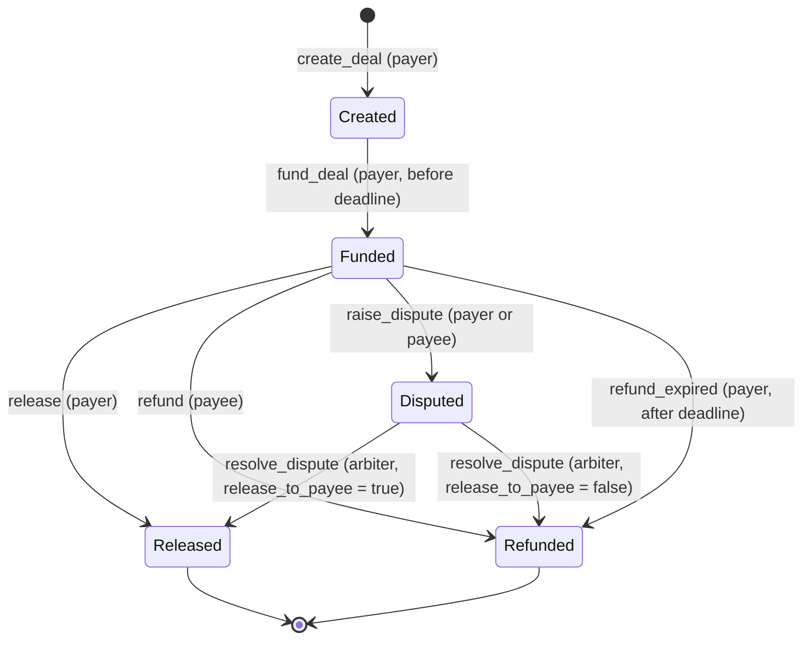

<div align="center">
  

  # orinex-core

  **Single-asset escrow for Soroban, with arbiter-settled disputes and a capped protocol fee.**

  [](https://github.com/Orinex-Soroban/orinex-core/actions/workflows/ci.yml)
  [](contracts/primary/src/test.rs)
  [](LICENSE)
  [](rust-toolchain.toml)
  [](Cargo.toml)
  [](Makefile)
  [](deployments/testnet.json)
</div>

---

## What this is

`orinex-core` is the contract layer for an escrow where two parties agree terms,
one funds them, and the money only moves when the terms are met or a named
arbiter settles a dispute. It holds one SEP-41 asset per deployment, takes a fee
in basis points capped at 10%, and gives the payer a deadline-based reclaim so
funds can't be stranded by an unresponsive payee.

There is no admin path to move escrowed money. The admin can change the fee
(within the cap) and the fee recipient — nothing else.

Not sure this is the right shape for what you're building? `docs/positioning.md`
is an honest read of where escrow already sits on Stellar, including where this
repo is weak against the incumbents.

## Maintainers

<table>
  <tr>
    <td align="center" width="200">
      <strong>Orinex</strong><br />
      <sub>Maintainer</sub><br /><br />
      <a href="https://github.com/Deyanju23">@Deyanju23</a><br />
      <a href="https://github.com/Orinex-Soroban/orinex-core/issues">Issues &amp; requests</a>
    </td>
  </tr>
</table>

## Contents

- [Architecture](#architecture)
- [Contract surface](#contract-surface)
- [Quick start](#quick-start)
- [Testnet deployment](#testnet-deployment)
- [Documentation](#documentation)
- [Contributing](#contributing)
- [Security](#security)
- [License](#license)

## Architecture

One contract, one responsibility: hold funds for a single agreed deal and settle
it exactly once.



- **Storage.** Instance for config and the deal counter; persistent for each
  `Deal`. Every read and write bumps the relevant TTL (instance: 7d threshold →
  30d; deals: 30d → 90d), so an active escrow cannot archive underneath its
  parties.
- **Money.** `soroban_sdk::token::Client` transfers, `amount > 0` enforced at
  creation, `i128` throughout, no floats anywhere. Fee is
  `amount * fee_bps / 10_000`, floored, in checked arithmetic.
- **Auth.** `require_auth()` on the exact party every state transition belongs
  to: payer funds, releases and reclaims; payee refunds; the deal's arbiter
  settles disputes.
- **Errors and events.** `#[contracterror]` codes are append-only and returned
  as `Result`; every transition emits a typed `#[contractevent]`, so indexers
  never need to diff storage.

## Contract surface

| Function | Auth | Status required | Notes |
|---|---|---|---|
| `initialize(admin, token, fee_bps, fee_recipient)` | admin | — | Once per deployment; `fee_bps <= 1000` |
| `set_fee_bps(fee_bps)` | admin | — | Capped at 1000 |
| `set_fee_recipient(fee_recipient)` | admin | — | |
| `create_deal(payer, payee, arbiter, amount, deadline)` | payer | — | Returns `u64` deal id |
| `fund_deal(payer, deal_id)` | payer | Created | Before deadline |
| `release(payer, deal_id)` | payer | Funded | Splits net + fee |
| `refund(payee, deal_id)` | payee | Funded | Full amount, no fee |
| `raise_dispute(caller, deal_id)` | payer or payee | Funded | |
| `resolve_dispute(deal_id, release_to_payee)` | arbiter | Disputed | Fee applies on release |
| `refund_expired(payer, deal_id)` | payer | Funded, past deadline | Full amount, no fee |
| `get_config()` / `get_deal(id)` / `get_deal_count()` | — | — | Read-only |

Full parameter and error detail: [`docs/contract-reference.md`](docs/contract-reference.md).

## Quick start

| Tool | Version |
|---|---|
| Rust | 1.92.0 (pinned by `rust-toolchain.toml`) |
| `stellar` CLI | 30.0.1 |
| Target | `wasm32v1-none` |

```bash
git clone https://github.com/Orinex-Soroban/orinex-core.git
cd orinex-core
rustup show                     # installs the pinned toolchain
rustup target add wasm32v1-none
cargo install --locked stellar-cli --version 30.0.1
make verify                     # fmt-check + clippy + 39 tests + wasm build
```

`make build` alone produces `artifacts/primary.wasm`. It goes through
`stellar contract build`: `soroban-sdk 30` refuses a plain `cargo build` for
wasm and tells you to use the CLI.

Rust 1.92.0 is pinned for a reason — `soroban-sdk 30` needs ≥ 1.91, and
`stellar-cli` rejects 1.91.0 specifically. Bumping the toolchain is its own PR.

## Testnet deployment

Recorded in [`deployments/testnet.json`](deployments/testnet.json), verified with
an on-chain `create_deal → fund_deal → release` cycle:

| | |
|---|---|
| Contract | [`CA43UELWFPN2YF2H77XIVCWR7KMBG66VHMKOOHO2YMD4Q5ODDGDRABZV`](https://stellar.expert/explorer/testnet/contract/CA43UELWFPN2YF2H77XIVCWR7KMBG66VHMKOOHO2YMD4Q5ODDGDRABZV) |
| Asset | native XLM SAC `CDLZFC3SYJYDZT7K67VZ75HPJVIEUVNIXF47ZG2FB2RMQQVU2HHGCYSC` |
| Fee | 250 bps |
| wasm sha256 | `deae51926429a785a0b21366e4b3f901135d573702a4261492b763f5c282a77a` |

Deploy your own:

```bash
export ADMIN=G...            # contract admin
export TOKEN=C...            # SEP-41 asset contract id
export FEE_RECIPIENT=G...
export FEE_BPS=250           # optional, default 250
make deploy-testnet
```

The script builds the wasm if needed, creates and funds a CLI identity when
absent, deploys, calls `initialize`, and rewrites `deployments/testnet.json`.
It never commits anything. Full walkthrough:
[`docs/developers/setup.md`](docs/developers/setup.md).

## Documentation

- [`docs/positioning.md`](docs/positioning.md) — landscape and honest assessment
- [`docs/protocol-mechanics.md`](docs/protocol-mechanics.md) — lifecycle, fees, worked numbers
- [`docs/contract-reference.md`](docs/contract-reference.md) — every function, error, event
- [`docs/guides/`](docs/guides/) — payer, payee and arbiter walkthroughs
- [`docs/developers/`](docs/developers/) — setup, SDK usage, event indexing

## Contributing

Issues are scoped and labelled (`good first issue`, `contract`, `tests`,
`docs`, `infra`). Claim one by commenting, then follow
[`CONTRIBUTING.md`](CONTRIBUTING.md): conventional commits, one logical unit per
commit, `make verify` green, no lint suppressions.

`main` is protected: PRs only, one approval, and the four CI checks (`rustfmt`,
`clippy`, `cargo test`, `wasm build`) must pass.

## Security

The contracts are **unaudited**. Don't put real money in a deployment of this
code before an independent audit. Report vulnerabilities privately via
[SECURITY.md](SECURITY.md) — not in a public issue.

## License

MIT — see [LICENSE](LICENSE).

## Contributors

<a href="https://github.com/Orinex-Soroban/orinex-core/graphs/contributors">
  
</a>
